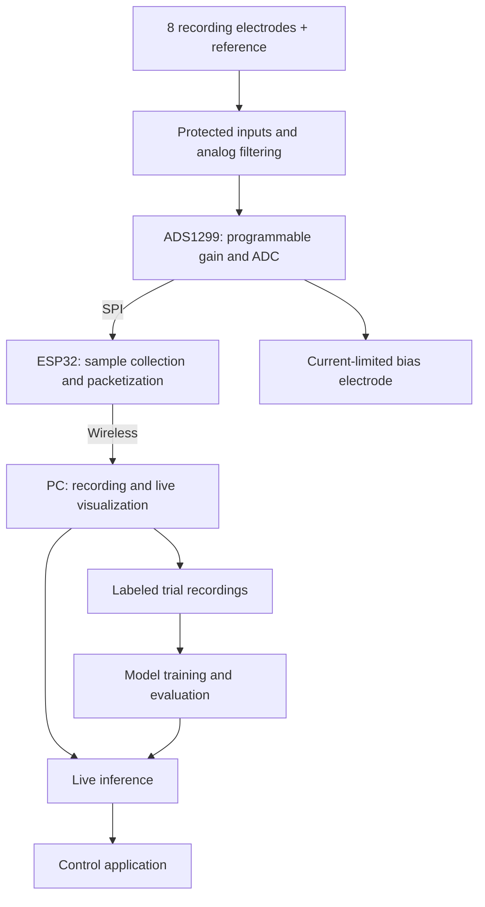

# CortexLink

### From scalp signals to software commands.

An experimental EEG brain–computer interface built around a custom acquisition PCB, an ESP32, and a PC-based signal-processing and machine-learning pipeline.

The goal is to build an affordable system that records usable EEG, supports repeatable experiments, and investigates whether trained brain-activity patterns can control a simple interface.

> **Status: design and planning.** The hardware, firmware, and classifier described below are proposed components. This repository does not yet provide a validated board, a working control system, or measured classification results.

## The idea

CortexLink will connect ten scalp electrodes to a custom board that conditions and digitizes the signals. An ESP32 will collect the samples and transmit them wirelessly to a computer for recording, visualization, and classification.

The long-term experiment is a directional controller with **left, right, up, down, and an idle state**. Commands would be mapped to distinguishable, deliberately practiced tasks, such as motor imagery, and calibrated to the individual user.

EEG measures electrical activity at the scalp; it does not directly reveal arbitrary thoughts or the meaning of a word someone imagines. Whether four command classes are practical will be determined through experiments, starting with simpler tasks.

## Project goals

- Design a custom EEG acquisition board with documented schematics and manufacturing files.
- Record eight synchronized EEG channels using ten electrodes in total.
- Preserve raw recordings and the metadata needed to reproduce an experiment.
- Build a live signal viewer and a workflow for collecting labeled trials.
- Evaluate a convolutional neural network against a simpler classification baseline.
- Demonstrate control only after measuring reliability, latency, and false activations.
- Publish the real build cost, including assembly, accessories, and shipping.

## Proposed architecture

This is a functional overview, not a wiring diagram. The wearable acquisition system is intended to operate from a battery and communicate wirelessly with the receiving computer.

## Hardware plan

| Component | Proposed approach | Purpose |
| --- | --- | --- |
| Electrodes | 10 reusable gold-plated cup electrodes | 8 recording sites, 1 shared reference, and 1 bias electrode |
| Electrode mounting | Conductive medium and suitable mechanical retention | Maintain stable scalp contact during a recording |
| Analog front end | TI ADS1299, eight-channel variant | Programmable amplification and simultaneous 24-bit analog-to-digital conversion |
| Input circuitry | Protection, current limiting, and analog filtering | Protect the inputs and manage interference before conversion |
| Acquisition controller | ESP32; exact module to be selected | Configure the front end, collect samples, and transmit data |
| Power | Battery with appropriate regulation | Supply the analog and digital circuitry |
| Receiver | PC initially; Raspberry Pi support may follow | Record signals, run experiments, and perform inference |
| PCB | Custom design; stack-up and assembly method to be selected | Integrate the acquisition electronics |

**Ten electrodes do not mean ten EEG channels.** In the proposed shared-reference arrangement, eight channels measure eight recording sites relative to a reference. The bias electrode helps control the body's common-mode voltage; it is not an additional recording channel or a protective earth connection.

An initial acquisition target is **250 samples per second per channel**, with 500 samples per second considered if the experiment requires it. These are design targets, not measured capabilities of this project.

The ADS1299 already contains programmable gain amplifiers and ADCs. The surrounding PCB still needs careful input circuitry, power design, routing, and validation. Its nominal 24-bit output does not imply 24 noise-free bits of EEG information.

Electrode positions will be chosen for the experiment. A forehead-only arrangement is not the assumed layout for motor-imagery trials.

## Software and data

The planned pipeline has four parts:

1. **Acquire:** configure the front end, read complete sample frames, and detect missing data.
2. **Record:** store raw channel values with sample counters, timing information, channel names, sample rate, reference arrangement, and gain/scale metadata.
3. **Prepare:** inspect signal quality, annotate trials, and apply documented preprocessing appropriate to the experiment.
4. **Classify:** train on labeled recordings, evaluate on separate data, and map sufficiently confident predictions to commands.

The ESP32 will handle acquisition and transport first. Model training will run on the PC. Processing on the wearable device can be considered after a useful classifier exists.

Raw recordings should remain available alongside processed data. Any live filtering must also be represented in evaluation so offline results reflect the intended real-time system.

## What counts as success?

The first milestone is a trustworthy recording, followed by a simple, repeatable EEG experiment. Four-direction control comes later.

Validation will cover:

- **Acquisition quality:** input noise, saturation, mains interference, sample timing, and packet loss.
- **Repeatability:** consistent recordings across multiple trials and sessions.
- **Classification quality:** per-class performance, a confusion matrix, and comparison with chance and a simple baseline.
- **Live behavior:** end-to-end latency and false commands during the idle state.
- **Confounds:** checks that eye movements, jaw tension, and other muscle activity are not driving an apparent EEG result.

Training and evaluation data will be separated by complete trials and, where possible, recording sessions. Overlapping windows from the same trial must not leak into both sets. Results will include the task, dataset size, split method, and preprocessing used.

## Roadmap

- [ ] Define the first experiment and electrode montage.
- [ ] Compare reference designs and select the analog front-end architecture.
- [ ] Produce a costed bill of materials and confirm component availability.
- [ ] Complete schematic, PCB layout, and design review.
- [ ] Manufacture and assemble the first revision.
- [ ] Validate power, communication, test signals, and input behavior on the bench.
- [ ] Review electrical safety before any body-connected recording.
- [ ] Implement raw streaming, recording, and live visualization.
- [ ] Collect a repeatable EEG dataset with synchronized trial labels.
- [ ] Evaluate a baseline classifier and a CNN on held-out data.
- [ ] Demonstrate live control with an idle state and measured false activations.
- [ ] Publish build instructions, costs, and experimental results.

## Planned repository layout

Directories will be added as their contents are developed.

| Directory | Intended contents |
| --- | --- |
| `hardware/` | Schematics, PCB source, BOM, fabrication outputs, and assembly notes |
| `firmware/` | ESP32 acquisition and wireless transport firmware |
| `software/` | PC receiver, recorder, signal viewer, and control demo |
| `ml/` | Preprocessing, baseline models, CNN training, and evaluation |
| `experiments/` | Trial protocols, dataset descriptions, and results |
| `docs/` | Architecture, setup, safety notes, and development decisions |

Personal recordings and large generated model files should stay out of version control by default. Any published dataset will need an explicit sharing decision and documentation.

## Building on a budget

Affordability is a design goal, not a fixed price promise. The BOM will track the front-end IC, other components, bare PCBs, assembly, electrodes, contact supplies, battery, enclosure, shipping, and taxes.

Reference designs will be studied before committing to a board. A custom PCB can reduce the eventual unit cost, but assembly, minimum order quantities, and board revisions can make a one-off prototype more expensive than expected. Cost comparisons will use the total cost of a working system.

## Electrical safety

This is an experimental, body-connected electronics project, not a medical device. It is not intended for diagnosis or treatment.

- During body-connected recording, use a self-contained battery-powered acquisition system with wireless communication.
- Disconnect all electrodes before charging, programming over USB, or attaching wired test equipment. A USB connection can defeat the intended separation from mains-powered equipment.
- Validate the board with test signals before attaching electrodes. Battery power alone does not establish electrical safety.
- Have the protection, current limiting, power paths, and overall design reviewed by someone qualified in body-connected electronics before human use.

## References and acknowledgments

These are engineering references to investigate; listing them does not claim that their designs have already been incorporated or that their authors endorse this project.

- [Texas Instruments ADS1299 product documentation](https://www.ti.com/product/ADS1299)
- [ADS1299 datasheet](https://www.ti.com/lit/ds/symlink/ads1299.pdf)
- [OpenBCI hardware design files](https://github.com/OpenBCI/V3_Hardware_Design_Files)
- [HackEEG hardware design files](https://github.com/starcat-io/hackeeg-shield)

Any reused design files or code must retain the required attribution and comply with their original licenses. Adaptations will be identified in the relevant directories.

## Contributing

Feedback on the analog front end, PCB layout, acquisition timing, experiment design, and evaluation methods is welcome. For proposed hardware changes, include the reasoning and relevant datasheet or reference-design links. For experimental results, include enough information to reproduce the analysis.

## License

The license for original project work has not yet been selected. Hardware and software licensing will be documented before reusable implementation files are released. Third-party materials retain their respective licenses.
