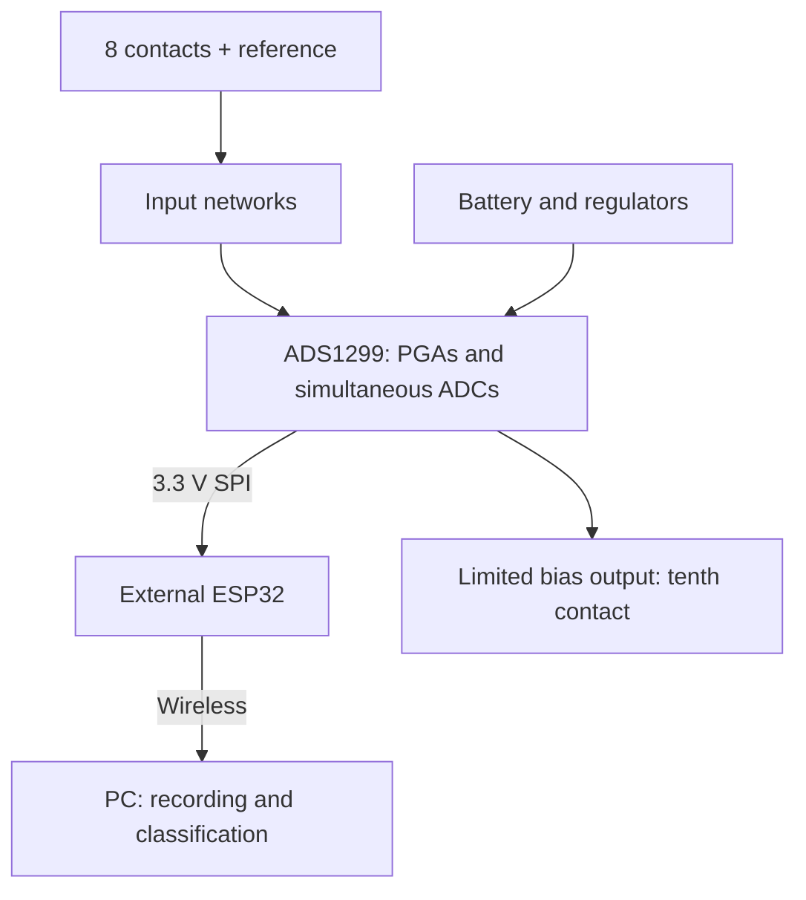

# Neuronic

An open development project for an affordable eight-channel EEG acquisition
PCB, ESP32 wireless streaming and PC-based signal processing and classification.

**Current revision A0.5** increases electrode series resistance, revises input filtering and rail discharge, updates the battery PTC and keys the controller harness. See the [protection review](docs/A0_5_PROTECTION.md) and [checked fabrication and hand-assembly files](hardware/fabrication/A0.5/). The Sino-k connector inquiry and assembled-system qualification are open.
There is no manufactured or body-validated Neuronic board yet. This repository
contains genuine KiCad source, not a manufacturing release.

**The target is a working eight-channel EEG instrument.** Bench testing is a
development phase; actual acquisition and person-use readiness still need
implementation, measurements and qualified system review. See the
[working-system acceptance plan](docs/SYSTEM_ACCEPTANCE_PLAN.md).

**November 19 follow-up:** the [independent November 17 report](docs/reviews/independent-577aad8-2026-11-17/REPORT.md)
is incorporated, the BOM prose is corrected, and a
[connector drawing/CAD audit](docs/CONNECTOR_VERIFICATION_A0_3.md) records what is
known and what still needs physical evidence. A0.5 fabrication data are available for review. Manufacturer selection and ordering are pending.

**A0.3 implements the main A0.2 review fixes:** revised analog routing,
stronger default logic pulls, two power-off tolerant interface buffers, extra
reference capacitance and revised socket mounting slots. Read the
[changes and remaining gates](docs/REVIEW_FIXES_A0_3.md). Historical
[A0.2 findings](docs/INDEPENDENT_REVIEW_A0_2.md) remain available.

**A0.5 controller cable.** Pin 1 is ground, position 2 is the mechanical key and must have no wire, pin 11 takes Nano 3V3, and pin 12 is GPIO6 enable. See the [cable pinout](docs/POWER_HARNESS_A0_3.md) and [keying instructions](docs/A0_5_PROTECTION.md).

**Controller selected: use the Waveshare ESP32-S3-Nano you already own.**
The Sino-k SGE117DN ten-lead set is recorded; P1 36619 touchproof sockets are selected; physical plug fit still needs verification. See [the wiring and power plan](docs/CONTROLLER_AND_ELECTRODES.md)
and [the step-by-step roadmap](docs/NEXT_STEPS.md).

**First time using KiCad? Read [START_HERE](docs/START_HERE.md).** Open
[`hardware/kicad/neuronic.kicad_pro`](hardware/kicad/neuronic.kicad_pro) in KiCad.

## System



| Parameter | A0.5 design target |
| --- | --- |
| Recording channels | 8 simultaneous |
| Contacts | 8 recording + 1 reference + 1 bias |
| Front end | ADS1299IPAG, programmable gain, 24-bit output |
| Initial rate | 250 samples/s/channel |
| Analog / ADC digital supplies | 5 V / 3.3 V |
| Input power | 6 x AA alkaline candidate; no charger |
| Controller interface | Waveshare ESP32-S3-Nano via 12-pin 3.3 V SPI header |
| PCB | 88 x 90 mm, four copper layers, routed bench prototype |

The ADS1299 already supplies the amplification and conversion. An additional
high-gain analog amplifier chain is not assumed. Nominal ADC bit depth is not
a claim of noise-free resolution, and more gain can reduce offset headroom.

## Repository map

| Path | Contents |
| --- | --- |
| `hardware/kicad/` | Main project, four schematic sheets, PCB, custom symbols and bundled footprints |
| `hardware/bom/` | Per-component and grouped candidate MPN lists; not an order release |
| `hardware/parts.json` | Editable candidate component catalog |
| `hardware/interface.json` | Selected controller GPIO, electrode and power contract |
| `hardware/design.json` | Generated component/net/placement record |
| `hardware/validation/` | Exported netlist, connectivity audit, DRC, RC calculation and sheet previews |
| `hardware/fabrication/` | A0.5 Gerber/drill package and assembly references for review |
| `firmware/` | Acquisition firmware specification; implementation pending |
| `software/` | PC receiver/recorder specification; implementation pending |
| `ml/` | Evaluation plan; no trained classifier yet |
| `experiments/` | Recording and validation protocols |
| `docs/` | Beginner guide, design decisions, open blockers and bench plan |
| `tools/` | Reproducible hardware generator and validation commands |
| `data/` | Local private recordings; contents ignored by Git |

The old CortexLink README is retained in `docs/archive/initial-README.md`.
The empty duplicate KiCad scaffolds were removed; their originals remain in
the repository history at `ae7d76e`.

## Verification

Read [the current status](hardware/validation/STATUS.md) before using the files.
Checks compare the **actual KiCad-exported netlist** with the source, component
footprints and an independent physical pin contract. They do not prove analog
performance, layout quality or body safety.

```bash
/usr/bin/python3 tools/validate_kicad.py
python3 tools/prepare_bom.py
python3 tools/review_electrical.py
python3 tools/check_contact_faults.py
python3 tools/simulate_input.py
/usr/bin/python3 -m unittest discover -s tests -v
```

Validation uses KiCad 9; on Linux use its compatible `/usr/bin/python3` for pcbnew. Read the current validation report for routing and CAD results; manufacturing and body-use approval remain separate. GUI ERC/DRC instructions are in the beginner guide.

See the [current protection review](docs/A0_5_PROTECTION.md) and [power and cable guide](docs/POWER_HARNESS_A0_3.md) for the circuit decisions and physical checks.

## Roadmap

- [x] Consolidate project and document circuit decisions.
- [x] Create editable KiCad sheets, footprint bundle, BOM and placed PCB.
- [x] Export and audit connectivity; perform limited ideal RC calculation.
- [ ] Close input-protection, connector, bias-loop and power-review blockers.
- [x] Complete a routed bench checkpoint with clean ERC and schematic-parity DRC.
- [x] Complete a separate AI review of the saved circuit and layout, with fresh checks and written findings.
- [x] Implement the main circuit/layout fixes and update checks/harness documentation.
- [ ] Verify physical fit and complete manufacturing-release review.
- [x] Select exact candidate PCB MPNs and the owned controller.
- [ ] Verify procurement details and compare delivered bare-board quotes.
- [ ] Fabricate a small prototype batch and complete bench tests.
- [ ] Implement and verify acquisition, raw recording and loss accounting.
- [ ] Review final body-connected design before scalp testing.
- [ ] Record repeatable EEG, then evaluate baselines and a CNN across sessions.

## Experiments and safety

The immediate target is trustworthy acquisition and a repeatable alpha
experiment. Intentional command classification follows measured signal quality.
EEG does not directly reveal arbitrary thoughts. Eye and muscle artifacts must
be checked, and train/test data must be separated by complete trials/sessions.

This is a body-connected engineering project, not a diagnostic device. A0.5 still needs
bench qualification and complete-system electrical safety review. Do not attach it to a person. Final electrode
protection and fault paths need qualified review before any scalp recording.
Battery power, ERC and DRC alone do not establish safety. During approved
recording, use a self-contained battery arrangement and wireless communication,
with USB, chargers and mains-connected instruments disconnected.

## Sources and licensing

See [design decisions and primary sources](docs/DESIGN_DECISIONS.md),
[open blockers](docs/REVIEW_BLOCKERS.md) and [third-party notices](hardware/licenses/).
The repository's existing MIT license is preserved for original work. Bundled
KiCad library assets retain their own license and design-use exception. No
third-party EEG hardware project has been silently relicensed or included.
