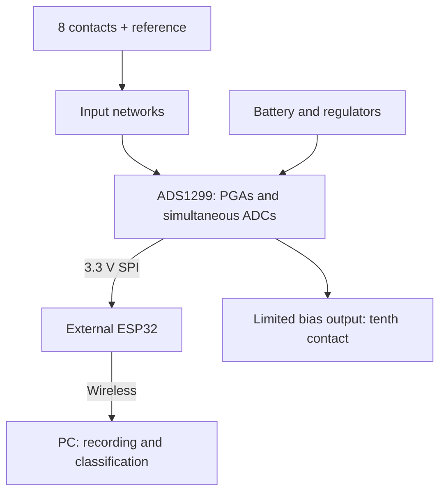

# Neuronic

An open development project for an affordable eight-channel EEG acquisition
PCB, ESP32 wireless streaming and PC-based signal processing and classification.

**Current revision: A0 — schematic and unrouted placement for bench review.**
There is no manufactured or body-validated Neuronic board yet. This repository
contains genuine KiCad source, not a manufacturing release.

**First time using KiCad? Read [START_HERE](docs/START_HERE.md).** Open
[`hardware/kicad/neuronic.kicad_pro`](hardware/kicad/neuronic.kicad_pro) in KiCad.

## System



| Parameter | A0 design target |
| --- | --- |
| Recording channels | 8 simultaneous |
| Contacts | 8 recording + 1 reference + 1 bias |
| Front end | ADS1299IPAG, programmable gain, 24-bit output |
| Initial rate | 250 samples/s/channel |
| Analog / ADC digital supplies | 5 V / 3.3 V |
| Input power | External 7-9 V battery pack; no charger |
| Controller interface | Generic 12-pin 3.3 V SPI header |
| PCB | 88 x 80 mm, four copper layers, placed and unrouted |

The ADS1299 already supplies the amplification and conversion. An additional
high-gain analog amplifier chain is not assumed. Nominal ADC bit depth is not
a claim of noise-free resolution, and more gain can reduce offset headroom.

## Repository map

| Path | Contents |
| --- | --- |
| `hardware/kicad/` | Main project, three schematic sheets, PCB, custom symbols and bundled footprints |
| `hardware/bom/` | Per-component review BOM; not an order list |
| `hardware/design.json` | Generated component/net/placement record |
| `hardware/validation/` | Exported netlist, connectivity audit, DRC, RC calculation and sheet previews |
| `hardware/fabrication/` | Release policy; no order-ready Gerbers |
| `firmware/` | Acquisition firmware specification; implementation pending |
| `software/` | PC receiver/recorder specification; implementation pending |
| `ml/` | Evaluation plan; no trained classifier yet |
| `experiments/` | Recording and validation protocols |
| `docs/` | Beginner guide, design decisions, open blockers and bench plan |
| `tools/` | Reproducible hardware generator and validation commands |
| `data/` | Local private recordings; contents ignored by Git |

The old CortexLink README is retained in `docs/archive/initial-README.md`.
The empty duplicate KiCad scaffolds were removed; their originals remain in
the repository history at `ae7d76e`.

## Verification

Read [the current status](hardware/validation/STATUS.md) before using the files.
Checks compare the **actual KiCad-exported netlist** with the source, component
footprints and an independent physical pin contract. They do not prove analog
performance, layout quality or body safety.

```bash
python tools/check_design.py
python tools/simulate_input.py
python tools/validate_kicad.py --kicad-cli /path/to/kicad-cli
```

The last command requires KiCad 8 or newer for CLI ERC/DRC. This unrouted
checkpoint is expected to fail release checks; errors are not excluded to
make the output look clean. GUI ERC/DRC instructions are in the beginner guide.

## Roadmap

- [x] Consolidate project and document circuit decisions.
- [x] Create editable KiCad sheets, footprint bundle, BOM and placed PCB.
- [x] Export and audit connectivity; perform limited ideal RC calculation.
- [ ] Close input-protection, connector, bias-loop and power-review blockers.
- [ ] Complete layout, plane design, routing, ERC and schematic-parity DRC.
- [ ] Select exact stocked parts and compare delivered assembly quotes.
- [ ] Fabricate a small prototype batch and complete bench tests.
- [ ] Implement and verify acquisition, raw recording and loss accounting.
- [ ] Review final body-connected design before scalp testing.
- [ ] Record repeatable EEG, then evaluate baselines and a CNN across sessions.

## Experiments and safety

The immediate target is trustworthy acquisition and a repeatable alpha
experiment. Intentional command classification follows measured signal quality.
EEG does not directly reveal arbitrary thoughts. Eye and muscle artifacts must
be checked, and train/test data must be separated by complete trials/sessions.

This is a body-connected engineering project, not a diagnostic device. A0 is
for bench development only. Do not attach it to a person. Final electrode
protection and fault paths need qualified review before any scalp recording.
Battery power, ERC and DRC alone do not establish safety. During approved
recording, use a self-contained battery arrangement and wireless communication,
with USB, chargers and mains-connected instruments disconnected.

## Sources and licensing

See [design decisions and primary sources](docs/DESIGN_DECISIONS.md),
[open blockers](docs/REVIEW_BLOCKERS.md) and [third-party notices](hardware/licenses/).
The repository's existing MIT license is preserved for original work. Bundled
KiCad library assets retain their own license and design-use exception. No
third-party EEG hardware project has been silently relicensed or included.
