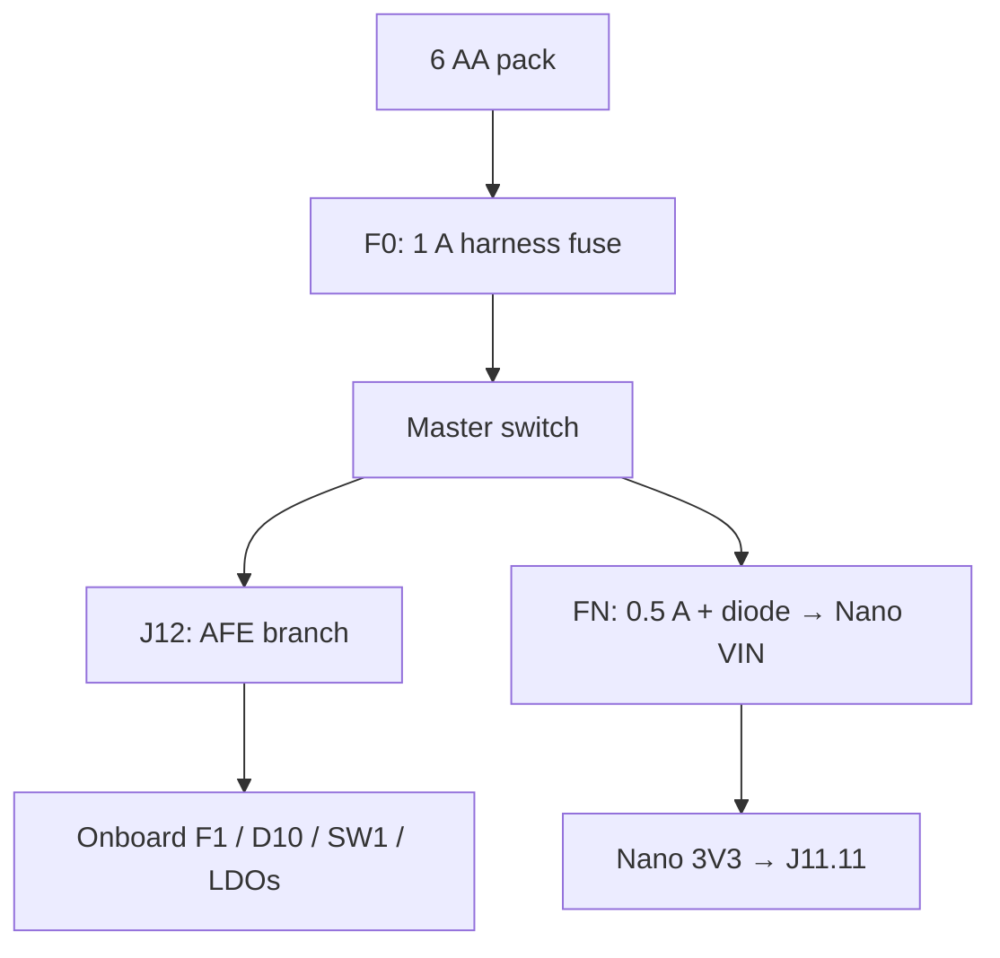

# A0.3 battery and controller harness — bench candidate

**A0.4 update.** See the [current circuit decisions, dimensions, budgets and checks](A0_4_DESIGN_REVIEW.md). The A0.3 figures below describe the earlier hardware. The Sino-k leads have not been ordered.

The circuit is shared-ground and **not galvanically isolated**. This is a wiring
proposal for an electrode-disconnected bench prototype, with physical verification
still pending. The Nano must not take its radio current from the AFE regulators.

## Battery branches

Use a six-AA alkaline pack, with 7.2–10.2 V at the pack terminals as the current
calculation range. A battery below that range is outside this review; there is
no automatic undervoltage cutoff. Do not substitute a lithium pack or charger
without a separate power review.

Battery negative runs separately to Nano GND and J12.2. J12.1 is positive.
Use short, insulated 22 AWG power pairs with strain relief and a covered battery
holder. Put F0 close to the pack positive terminal, before the switch and branch
split. Keep the unfused lead short and mechanically protected. Route the Nano
power pair away from the analog inputs. J11.1/.2 provide the signal return.
SW1 on the AFE can be fitted with a shunt for normal master-switch operation;
it is not the system master switch and does not turn the Nano off.

| Item | Concrete candidate / requirement | Qualification still needed |
| --- | --- | --- |
| F0 | Littelfuse 0251001.MXL, 1 A axial 251-series fuse | Total load, inrush, ambient derating and pack fault-current capability |
| FN | Littelfuse 0251.500MXL, 0.5 A axial 251-series fuse, Nano branch only | Nano startup/radio pulses must not nuisance-trip it |
| Nano polarity diode | Vishay 1N5819-E3/54, banded cathode toward VIN | VIN droop and dissipation; install in covered offboard wiring |
| Master switch | DC-rated ≥12 V, ≥1 A; C&K 7101SYZQE is a reference candidate | Enclosure/price choice and actual terminal continuity |
| Holder and wiring | Covered 6-AA holder; insulated leads/contacts rated for the selected fuses | Exact holder, insulation, mechanical support and solder-joint inspection |

The SPDT reference switch can act as ON/OFF by using its common and one throw;
leave the other throw unconnected and insulated. Verify contact identity with a
meter before assembly. A cheaper switch with verified equivalent DC ratings is
acceptable. These offboard candidates are separate from the PCB BOM, and are
not a shopping release.

Fuse ratings are not hard current clamps. FN limits a wiring fault; it does not
establish a safe electrode current. With a 0.6 V diode allowance and 0.3 V
allowance for the Nano fuse/wires, the 7.2 V low endpoint gives a conditional
6.3 V at VIN. This is only 0.3 V above the Nano's documented 6 V minimum: measure
burst droop before accepting the harness. The AFE's existing fuse/diode/drop
calculation remains separate. Verify the total F0/switch/wire drop remains inside
its 0.1 V allowance at the measured combined load, or recompute the AFE margin.

## J11 cable — incompatible with the A0.2 cable

**Pin 11 is now Nano 3V3. Pin 12 is now GPIO6 enable, not GND.** Do not reuse an
A0.2 harness without rewiring and continuity testing. Use the square pad to
identify pin 1 and the KiCad assembly drawing to verify numbering.

| J11 pin | Net | Nano label | Native GPIO | Direction at Nano |
| --- | --- | --- | --- | --- |
| 1, 2 | GND | GND | — | Common return |
| 3 | HOST_SPI_SCLK | D2 | 5 | Output |
| 4 | HOST_SPI_MOSI | D11 | 38 | Output |
| 5 | HOST_SPI_MISO | D12 | 47 | Input |
| 6 | HOST_ADS_CS_N | D10 | 21 | Output |
| 7 | HOST_ADS_DRDY_N | D9 | 18 | Input / interrupt |
| 8 | HOST_ADS_RESET_N | D8 | 17 | Output |
| 9 | HOST_ADS_START | D7 | 10 | Output |
| 10 | HOST_ADS_PWDN_N | D6 | 9 | Output |
| 11 | HOST_3V3 | 3V3 | — | Powers U4/U5 A ports only |
| 12 | IF_EN | D3 | 6 | Output, HIGH enables buffers |

Begin with a short cable (approximately 10 cm or less as a bench routing target),
keep it off the electrode side, and verify edges at the receiver. This length is
not a tested signal-integrity limit. No 5 V logic or battery voltage belongs on
J11. Host and AFE 3.3 V rails are distinct; do not join them together.

## Power sequence and tests

1. Disconnect every electrode from a person and remove external analog sources.
   Wire with both boards off. Inspect polarity and check the complete harness.
2. Firmware starts with GPIO6/IF_EN LOW. Establish SCLK/MOSI/CS/RESET/START/PWDN
   LOW while the buffers are disabled. Keep bias and lead-off disabled.
3. Turn on the master supply. Confirm both rails. Enable the interface, release
   PWDN and allow startup. Before reset/configuration, establish the required
   power-on interval **and measure VCAP1 >1.1 V**. The board has no automatic
   VCAP1 monitor, so firmware delay alone cannot certify this condition.
4. Configure and read back registers, confirm reference settling, then start
   internal-test acquisition. Clear stale DRDY events before starting a session.
5. On shutdown stop conversions, assert RESET/PWDN LOW, disable IF_EN, then turn
   off the master supply. Rewiring remains a powered-off operation.
6. On a current-limited fixture, test host-only, AFE-only, either order, both off,
   slow discharge and brownout. Record rail/pin voltages and currents. Include
   host reset and disconnected VCCA/VCCB cases; automatic buffer isolation is
   not a blanket claim about every intermediate brownout voltage.

For USB programming, disconnect the battery harness first and keep the electrode
set disconnected. Power the Nano by USB on the bench; if needed, power the AFE
from a separate current-limited bench source with the documented common ground.
No USB/charger/instrument connection is permitted in any later body-connected
arrangement unless a separate qualified system review explicitly covers it.
The current board is not approved for body use.

## Sources

- [Waveshare Nano documentation](https://docs.waveshare.com/ESP32-S3-Nano) and
  [schematic](https://files.waveshare.com/wiki/ESP32-S3-Nano/ESP32-S3-Nano-Schematic.pdf).
- [TI TXU0304](https://www.ti.com/lit/ds/symlink/txu0304.pdf), supply-disconnect,
  OE and electrical limits; [ADS1299](https://www.ti.com/lit/ds/symlink/ads1299.pdf), startup.
- [Littelfuse 251 series](https://www.littelfuse.com/assetdocs/littelfuse_fuse_251_253_datasheet.pdf?assetguid=f47a0bb7-8ede-4679-9646-7114c3787688).
- [Vishay 1N5819 family](https://www.vishay.com/docs/88525/1n5817.pdf).
- [C&K switch selection guide](https://www.ckswitches.com/media/2222/shortform.pdf)
  (manufacturer site is migrating to Littelfuse; confirm the selected part's current sheet).
