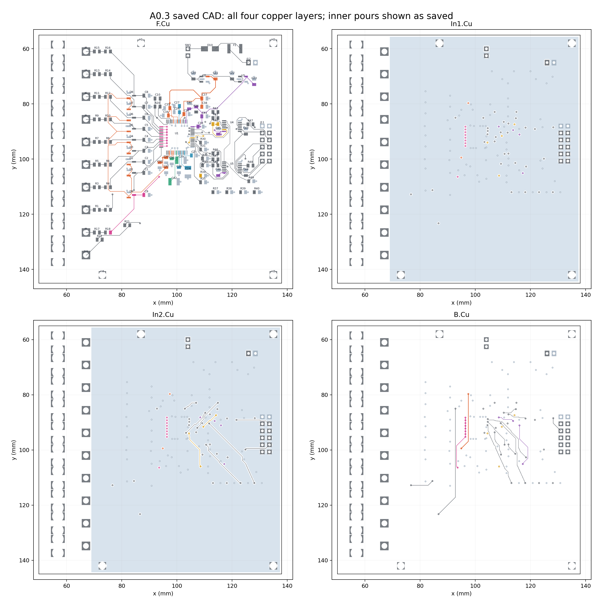
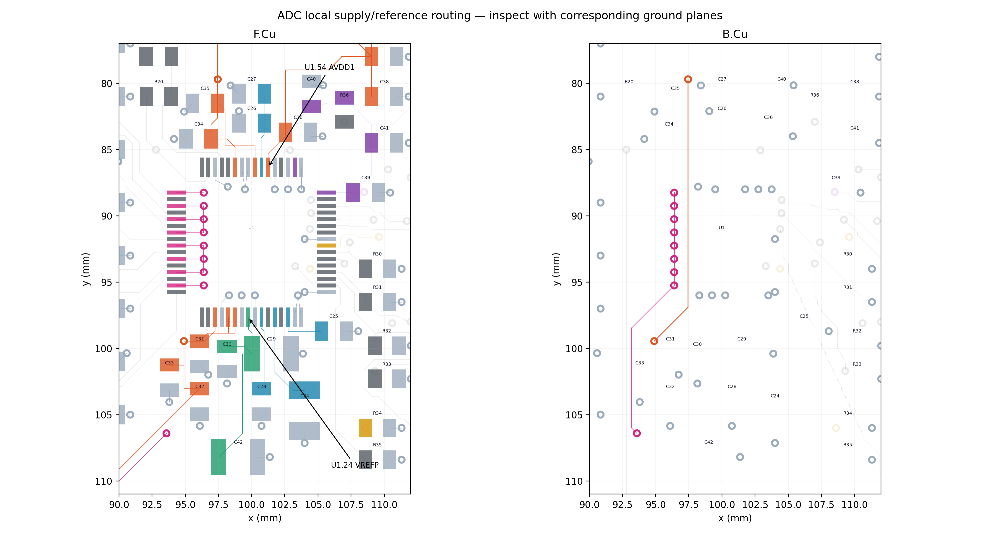
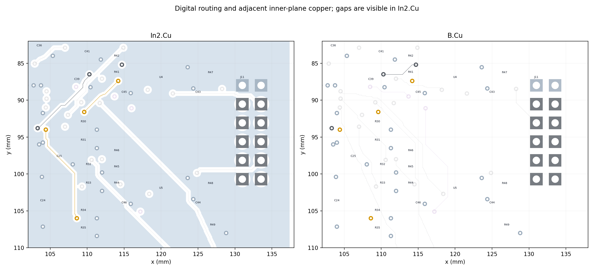

# Engineering evidence and calculations

Companion to [REPORT.md](REPORT.md), same reviewed SHA. `[D…]`, `[F1]` and `[V…]` refer to [SOURCES.md](SOURCES.md). Arithmetic is reproducible in [independent_calculations.py](evidence/independent_calculations.py); it is **not SPICE or measured board performance**. Geometry comes from saved CAD, not `design.json`.

## Circuit and pin audit

The [64-row audit](evidence/ADS1299-pin-audit.csv) records expected manufacturer function, actual fresh-netlist function/net, actual PCB pad net/coordinate and disposition. No wrong connection was found. The supporting circuit conclusions are:

| Function | Actual implementation | Review conclusion / condition |
| --- | --- | --- |
| Eight P/N channels | U1 even pins 2–16 map EEG8→EEG1; odd pins 1–15 all `REF_FILTERED` | Correct recording-minus-reference polarity. Eight channels use one ADC, not eight ADC chips. Shared reference/bias contacts do not consume two extra recording channels. |
| Analog supply/ground | AVDD 19,21,22,54,56,59 at `AVDD_5V`; AVSS 20,23,32,53,57,58 at GND | Correct unipolar arrangement, including AVDD1/AVSS1 and charge-pump supply/ground. Nominal 5V is within D1's 4.75–5.25V operating range. |
| Digital supply/ground | DVDD48/50 = separate AFE3.3V; DGND33/49/51 = common GND | Correct domain. GND is not isolated from Nano ground. |
| Internal reference | VREFN25=GND; VREFP24 has C29+C42 (22µF each) and C30 (100nF) | Must enable internal reference in CONFIG3. The common electrode reference `REF_FILTERED` is a different net/function from VREFP. |
| VCAP1 | U1.28, C24 100µF tantalum, positive pad1 to VCAP1 | Matches specified capacitance and polarity. Startup/leakage require measurement. |
| VCAP2 / VCAP3 / VCAP4 | U1.30→C25 1µF; .55→C26 1µF||C27 100nF; .26→C28 1µF | Required networks present. |
| Reserved/NC | RESV1.31 directly GND; NC27/29 and reserved64 open | Correct against D1 pp6–7. |
| Clock and unused digital | CLKSEL52 via R36 10k to DVDD; CLK37 open; DAISY_IN41 GND; GPIO42/44/45/46 through R37–40 10k to GND | Internal clock selected. Keep CLK_EN=0 and GPIO directions as inputs. GPIOs are not left floating. |
| Optional analog switches | SRB1.17, SRB2.18 open; BIASIN62 GND; BIASREF60 open | Valid for the declared mode with SRB1/SRB2 off, BIAS_MEAS=0 and internal bias reference selected. These are not disconnected required electrode pins. |
| Bias feedback | R20 1MΩ || C10 1.5nF from BIASOUT63 to BIASINV61; 2×499k to J10 | Feedback polarity is correct; loop stability is not thereby established. |
| Input clamps | BAV199 pad1=A1→GND; pad2=K2→AVDD; pad3 common K1/A2→signal | Correct two-rail diode orientation. Not an independent safety barrier or guaranteed low-voltage clamp. |
| Regulator pin4 | U2/U3 fixed TPS7A24 DBV pin4 tied GND | Explicitly permitted by D2; it is not an accidentally grounded feedback pin of the adjustable variant. |

The cap-to-supply assignments and all other component pins are in [schematic-connectivity.txt](evidence/schematic-connectivity.txt). Unused legacy footprints in the project library are not populated defects; actual board instances and candidate MPNs control the audit.

## Input quality and headroom

Each channel and the shared reference has 2×10kΩ series resistance followed by 1nF to GND, with a rail clamp after the resistors. At nominal values:

- `fRC = 1/(2π × 20k × 1nF) = 7957.75Hz`.
- The 50Hz amplitude change of that individual RC is approximately **−0.000171dB**. It cannot remove mains interference.
- At 300K, integrated Johnson noise from one 20kΩ path over 0.5–40Hz is **0.1144µV RMS**; independent P and reference resistors combine to **0.1618µV RMS differential**. This excludes electrode noise, ADC noise, resistor excess noise, leakage and interference. It is not a reason by itself to buy expensive precision resistors.
- Shared-reference resistor noise is correlated across the eight channel outputs, not eight independent noise sources summed into each channel. Re-referencing can cancel some common recorded noise; it cannot undo clipping or all unequal transfer functions.

The ADS1299's delta-sigma modulator and digital decimation filter must be included in bandwidth/alias analysis [D1 §9.3.1.3.3/§9.3.2]. Calling a 7.96kHz analog pole automatically invalid because the output rate is 250SPS would apply the wrong simple Nyquist-ADC model. Conversely, the digital filter does not make RF/cable pickup irrelevant; repeated modulator-band responses and nonlinear demodulation still warrant real interference tests.

### Common-mode sensitivity model

Use `H(f)=1/(1+j2πfRC)` and evaluate `|H_P−H_N|`. Input source impedances are included in R; explicit loading assumptions are included in C. CMRR below is `−20log10(|H_P−H_N|)` relative to the applied common-mode voltage. This is an external mismatch model, not the ADC's intrinsic CMRR specification.

| Assumption | 50Hz rejection | 60Hz rejection | Differential from 100mV CM at 50Hz |
| --- | ---: | ---: | ---: |
| Opposed 1% R and 5% C tolerance only | 62.45dB | 60.87dB | 75.4µV |
| Equal nominal components; illustrative 20pF per ADC input (one versus eight) | 61.11dB | 59.53dB | 88.0µV |
| Both above, mismatch directions reinforcing | 55.68dB | 54.09dB | 164.5µV |
| Nominal parts plus shared illustrative C, reference source +5kΩ | 51.37dB | 49.78dB | 270.2µV |
| Same with reference source +50kΩ | 34.38dB | 32.80dB | 1909µV |

The 20pF figure is a **typical input-capacitance illustration**; its treatment as identical capacitance to ground on each input is not a validated ADS macromodel. Electrode impedance is complex and frequency-dependent, and actual cable capacitance/topology is unknown. Thus neither the numbers nor a pass/fail conclusion can be transferred directly to a person. They justify the impedance/load sweep in IR-04.

Using 300pA as an input-bias-current scale gives 6µV across a channel's 20kΩ and 48µV if eight equal, same-sign currents flow through the reference's 20kΩ: 42µV differential in that assumed case. Directions, process/temperature and electrode/cable leakage matter; the shared connection does not magically avoid reference-current loading.

For the BAV199, the listed 5nA maximum reverse leakage at 75V and 25°C would correspond to 100µV across 20kΩ **if that current occurred**. The actual rail reverse biases are about 2.5V, not 75V, and upper/lower leakage can partly cancel. Therefore 100µV is a sensitivity bound, not predicted board offset. Typical roughly 2pF diode capacitance is small beside 1nF but still belongs in a matched-path model. Dirty flux, moisture and connector leakage can swamp picoampere-scale assumptions; clean and verify the assembled board rather than relying on ideal component values.

### Gain and electrode DC offset

For unipolar 5V, D1 equation4 requires:

`0.2 + G|Vdiff|/2 < VCM < 4.8 − G|Vdiff|/2`, with `VCM=(VP+VN)/2`.

The converter's separate full-scale condition is `|Vdiff| ≤ VREF/G`. At G=12 and VREF≈4.5V this gives ±375mV, but **that alone is not a guaranteed single-electrode DC-offset allowance**.

If VN is fixed at 2.5V and VP changes by d, VCM also changes by d/2. The combined limit is approximately `min(4.5/G, 4.6/(G+1))`:

| Gain | Ideal ADC full scale | Maximum one-input offset with VN=2.5V, AVDD=5V |
| --- | ---: | ---: |
| 6 | ±750mV | ±657mV |
| 12 | ±375mV | **±354mV** |
| 24 | ±187.5mV | **±184mV** |

At AVDD=4.9V with VN=2.45V, the G=12 bound becomes approximately ±346mV. Real operation needs margin for bias error, electrode offsets, motion and common-mode pickup. A ±300mV differential at G=12 requires 2.0–3.0V pair common mode; ±350mV narrows that to 2.3–2.7V. Grounding external inputs on this unipolar board is not a valid general-purpose low-noise fixture.

A practical response is to begin external tests at lower gain when necessary, record DC/clip status, then raise gain when measured margins permit. Do not infer that a high-pass filter in the PC can recover information lost to PGA saturation.

## Bias network

`Rf=1MΩ`, `Cf=1.5nF` gives 106.10Hz. The 998kΩ contact resistance isolates capacitive loading to some extent but also reduces drive and introduces load-dependent dynamics. For 0.5/1/5nF, the standalone contact RC corners are 318.95/159.47/31.89Hz. These numbers are not a full feedback-loop transfer function.

D1 Fig38 and associated drawings show 220kΩ bias summing resistors; its application text/equation11 uses 330kΩ. With N selected equal paths, the simple low-frequency summing gain magnitude would be `N×1M/Rinternal`, or 72.7 versus 48.5 for N=16. That discrepancy prevents claiming an exact gain or phase margin from those drawings. Both values are retained in the calculation file. No vendor model was obtained or run to resolve it.

Selecting P+N pairs can cancel the differential contribution to a common-mode estimate. All eight negative inputs physically sharing a reference does not make that choice inherently erroneous. It does change the interpretation of weights and disconnections. Record the exact sense mask in every bias test; evaluate disconnected/saturated channels rather than allowing them to dominate an average.

Lead-off excitation remains disabled initially. If implemented later, D1's common-reference discussion on p69 calls for avoiding multiple lead-off current sources on the common node; do not enable eight negative-side sources without analyzing their aggregate current and offsets.

## Power budget and sequencing

The reviewed harness is six AA alkaline cells with a **declared**, not measured, 7.2–10.2V pack range. F0/master switch precede separate AFE and Nano branches. Nano receives its own fuse and diode into VIN; it must not draw radio power from U2/U3. The exact cell/holder impedance, pulse current and master switch are not qualified.

At a deliberately conservative 30mA analog +10mA digital allocation, F1's assumed 15Ω high resistance gives 0.6V drop. Allowing 0.5V for D10 and 0.1V common harness drop leaves 6.0V at the LDO inputs from a 7.2V pack. A 5.1V output plus 0.25V dropout allowance leaves 0.65V margin. These assumptions need real current and temperature measurements; the ADS typical currents are lower and are not guaranteed maximum board current.

A combined 2% regulator budget (accuracy, line and load allowances) gives AVDD4.90–5.10V and DVDD3.234–3.366V under the relevant conditions. Upper dissipation estimates are about **0.159W U2** and **0.0697W U3**; multiplying by the DBV JEDEC 167.8°C/W value gives approximately 26.7°C/11.7°C rise. Actual copper, air, enclosure and load alter that result. This is a useful check against an obviously impossible LDO choice, not a measured junction temperature. Regulator noise/PSRR must be evaluated at the actual rails/load and frequencies; a single datasheet noise number at another output voltage cannot predict EEG noise.

Direct AVDD capacitance is nominally 20.8µF (C21, C31–38); direct DVDD capacitance is 7.0µF (C23, C39–41, C45/46). A tolerance/temperature-only high estimate for the former is 26.312µF, below D2's 50µF effective recommendation. VCAP and buffered VREF capacitors are not directly parallel output capacitors. The 4.7µF output parts and their typical bias curves are plausible, with exact effective values and stability still to be measured.

The Nano branch's 0.6V diode plus 0.3V fuse/wiring allowances leave only **6.3V** at VIN at the low endpoint, versus the documented 6V minimum. Radio bursts, cold/used cells and PPTC resistance can change the budget. There is no automatic pack cutoff or analog power-good input in this board. The Nano ground can return by both its battery wire and J11/AFE ground: these are parallel real paths, not an ideal star drawn on paper.

### Supply-state matrix

| State | Path / expected safeguard | Remaining verification |
| --- | --- | --- |
| Both boards off, no external stimulus | All rails nominally discharged | Discharge time/residual charge; no assumption of instant zero volts. |
| Nano on, AFE off | TXU VCCB off/disconnected disables outputs; ADC control pull-downs | Ioff/rail rise with actual cable; intermediate rail voltages are not covered by a blanket “off” claim. |
| AFE on, Nano off | TXU VCCA off/disconnected disables outputs; R49 disables OE | Host rail backfeed/leakage; GPIO/control states during collapse. |
| Both valid, IF_EN low | Buffer outputs disabled, R30–35 define ADC low inputs | Confirm thresholds and no unintended wake; CS low is deliberate alongside PWDN/RESET low. |
| Both valid, IF_EN high | Three A→B and one B→A paths per TXU | Actual rise/fall edges, setup/hold, correct GPIO configuration. |
| AVDD failed, DVDD and host valid | TXU remains powered; it does not sense AVDD | ADS recommended AVDD−DVDD relationship violated; reject data and reset/reinitialize after recovery. |
| DVDD falling, AVDD valid | Buffer isolation helps at specified supply-off conditions | Undefined/intermediate region, digital injection, loss of configuration. |
| Host reset/radio transient | R49 gives default disable when host pin is high impedance; separate power branch helps | Reset pin defaults/glitches, ground bounce, low-pack droop; record waveforms. |
| AFE switched off with external input driven | Input clamps can charge AVDD and possibly LDO input/other rails | Bounded injection, reverse current, phantom powering; D10 isolates upstream battery but is not a universal cure. |
| Upstream pack/input collapses | D10 helps retain/isolate local input capacitor charge, as in TI's input-diode mitigation | Local VBAT fault and relative IN/OUT discharge waveforms still require testing. |
| USB programming / grounded instrument attached | Grounds are conductively connected to AFE | Bench-only, electrodes disconnected from people; isolation has not been established. |

TPS7A24 EN is tied to its own input. It has no coordinated analog/digital sequencing here. Normal independent regulator start times are not by themselves a proven defect; the important issue is whether measured pins/rails remain within required limits and the recorder recognizes invalid states.

## Digital interface and firmware audit

U4/U5 are **TXU0304PWR / PW14**, not generic bidirectional level shifters. A supply pin1 is HOST_3V3; B supply pin14 is AFE DVDD; pin7 is common GND; OE8 is `IF_EN` with R49=10kΩ to GND. Pins2/3/4 are A inputs →13/12/11 B outputs; B input10→A output5; NC6/9 open. The PCB directions match the signal flow. C43/44 decouple host supply and C45/46 decouple AFE supply. Part-level supply-off tolerance is not transformer/optical isolation.

| J11 | Signal | Native GPIO / Nano label | Direction |
| --- | --- | --- | --- |
| 1,2 | GND | GND | Shared return |
| 3 | SCLK | 5 / D2 | Nano→ADC |
| 4 | MOSI | 38 / D11 | Nano→ADC |
| 5 | MISO | 47 / D12 | ADC→Nano |
| 6 | CS_N | 21 / D10 | Nano→ADC |
| 7 | DRDY_N | 18 / D9 | ADC→Nano |
| 8 | RESET_N | 17 / D8 | Nano→ADC |
| 9 | START | 10 / D7 | Nano→ADC |
| 10 | PWDN_N | 9 / D6 | Nano→ADC |
| 11 | HOST_3V3 | 3V3 | Powers TXU A sides |
| 12 | IF_EN | 6 / D3 | Nano enables interface |

These agree with Waveshare's drawing. GPIO5 is a routed clock candidate rather than blindly using the Nano-labelled SCK/GPIO48 line associated with the onboard LED. Firmware must use **native GPIO numbers** and an appropriate peripheral mapping; there is no executable firmware yet to prove it does.

R30=CS, R31=RESET, R32=PWDN, R33=START, R34=SCLK, R35=MOSI are all 10kΩ to GND. A conservative 12µA combined leakage assumption through a +1% 10k gives 0.1212V, versus ADS VIL=0.2DVDD≈0.647V at the budgeted low rail. This supports the static default, not every dynamic reset/brownout event.

The proposed register values were checked against D1 tables, independently of `interface.json`:

| Setting | Interpretation / review |
| --- | --- |
| CONFIG1=0x96 | Nominal 250SPS, internal clock output disabled. Single device does not require a second converter or external clock. |
| CONFIG2=0xD0 test / 0xC0 external | Internal calibration source enabled only for test. |
| CONFIG3=0xE8 | Internal reference on; internal midrail bias reference selected; bias amplifier off; bias measurement off. |
| CH1–8SET=0x55 / 0x51 / 0x50 | Gain12 field101, SRB2 off; internal-test / internal-short / normal mux respectively. Gain24 is a different field. |
| MISC1=0 | SRB1 off, appropriate for the physically common negative inputs. |
| BIAS_SENSP/N, LOFF_SENSP/N and LOFF_FLIP=0 | No bias sensing or lead-off excitation for the first milestone. |
| GPIO=0x0F; MISC2/CONFIG4=0 | GPIO inputs; reserved bits and continuous-conversion intent consistent. |
| `(ID & 0x1F)==0x1E` | Checks ADS1299 family and eight channels without hardcoding revision bits. |

SPI mode1, MSB-first and 27-byte frames are consistent with D1. At 1MHz, 216µs/frame is only 5.4% of a nominal 4ms period before software overhead. The four-master-clock command-decode interval is nominally 1.953µs; an 8µs byte at 1MHz is compatible, but CS and command boundaries still need a logic-analyzer capture. Do not infer wire timing from API call duration.

For CAL_FREQ=00, the nominal internal-test frequency is 2.048MHz/2^21=0.9765625Hz. The register-table amplitude formula gives magnitude VREF/2400≈1.875mV and ideal magnitude about 41,943 codes at gain12. **D1's summary electrical table also lists approximate ±1/±2mV, inconsistent with that register formula at 4.5V.** Use the explicit register equation as the initial expectation and investigate observed differences against independent external calibration rather than calibrating the software to whichever value makes a self-test pass. Clock tolerance, test-source accuracy and digital-filter settling must be accounted for. Signed ±24-bit boundaries and the status prefix need separate software tests.

## Actual copper geometry

This overview is rendered from extracted saved copper. Pad corners/holes and drawn line widths are simplified for visibility; **do not use these PNGs as fabrication drawings**. Exact native exports are [F.Cu](evidence/cad-exports/neuronic-F_Cu.svg), [In1.Cu](evidence/cad-exports/neuronic-In1_Cu.svg), [In2.Cu](evidence/cad-exports/neuronic-In2_Cu.svg), [B.Cu](evidence/cad-exports/neuronic-B_Cu.svg), masks and F.Fab in the same directory. Coordinates are board millimetres. GND is blue-grey, AVDD orange, DVDD purple, VREFP green, REF_FILTERED magenta, VCAP blue.

The outline is (50,55) to (138,145)mm. There are **1181 track segments**, **123 through vias**, and two saved GND zones. Track counts: F.Cu720, In1.Cu0, In2.Cu146, B.Cu315. In1 is an un-routed ground layer with normal pad/via antipads; In2 has signal/power routes cutting local ground regions. No deliberate split between separate analog/digital ground nets exists. Neither a zone count nor one connected DC net proves low high-frequency return impedance.

The independent graph measures pad-centre-to-pad-centre copper centerlines, includes pad endpoint joins, excludes via barrel length and does not model current spreading through planes. Exact paths are retained in [geometry-measurements.json](evidence/geometry-measurements.json).

| Route | Length | Layer transitions | Interpretation |
| --- | ---: | ---: | --- |
| U1.24 VREFP→C29.1 | 2.851mm | 0 | Local primary reference capacitor. |
| U1.24→C30.1 / C42.1 | 4.954 / 12.112mm | 0 / 0 | Local HF cap and a farther parallel reservoir; farther cap does not erase the local capacitor. |
| U1.28 VCAP1→C24.1 | 6.951mm | 0 | Reasonable local feed; return loop must also be considered. |
| U1.30 VCAP2→C25.1 | 3.566mm | 0 | Local. |
| U1.55 VCAP3→C26.1 / C27.1 | 3.420 / 5.620mm | 0 / 0 | Both specified capacitors present. |
| U1.26 VCAP4→C28.1 | 5.553mm | 0 | Return separation is a remaining opportunity, not missing ground. |
| U1.54 AVDD1→C36.1 | 3.176mm | 0 | Dedicated local bypass. |
| C37.1→C36.1 | 12.214mm | 0 | Distinct AVDD1 branch from reservoir. |
| U1.59→C34.1 | 3.586mm | 0 | Charge-pump supply local bypass. |
| U1.48→C39.1 / U1.50→C40.1 | 1.988 / 5.282mm | 0 / 0 | Digital bypasses. |
| C9.1 REF_FILTERED→U1.1 / .15 | 30.593 / 23.593mm | 2 / 2 | Common reference trunk/fanout, not independent filtered returns. |
| U4.13→R41.1 SCLK | 11.257mm | 0 | 33Ω not electrically adjacent to source. |
| U4.12→R42.1 MOSI | 10.289mm | 2 | Output damping still exists; position worth measuring. |
| U4.11→R43.1 CS | 7.712mm | 0 | Same caution. |
| U5.13/.12/.11→R44/R45/R46 | 11.294 / 22.035 / 9.971mm | See path file | START has the longest pre-resistor segment. |
| U4.5→R47.1 / U5.5→R48.1 | 2.925mm each | 0 | More local buffer-to-host damping. |

The AVDD1 branch leaves C37 near (109.05,78), runs through (106.8,78), (105.8,79), (102.55,79) and C36 near (102.55,83.7) before U1.54. Other AVDD loads leave the common reservoir on another branch. This is a real layout improvement relative to a daisy chain through noisy local loads; it is still one electrical supply net.

Local capacitor ground stubs are about 0.9–1.2mm to vias. U1 ground-pad escapes are roughly 1.66–1.89mm. Selected via-to-via straight-line paths for C24, C28, C29, C30 and C36 are covered by In1 fill at all 201 sampled points. C24's selected ground return spans about 11.15mm and C28's about 9.86mm; C29 is 5.70mm. C39's selected straight line has 168/201 filled points because of antipads. This is **not proof of a disconnected ground**: real current can spread around holes. Nor does 201/201 prove a minimum-inductance return.

Native fill sampling identifies B.Cu DRDY and MOSI crossings over In2 gaps, with In1 copper still present at the quoted IR-09 locations. A local adjacent-plane interruption can alter edge return paths without breaking DC connectivity. The source trace before the resistor, edge rise time, actual dielectric thickness and probe load matter more than the 1MHz clock frequency alone. Ground stitching and local bypass changes should be driven by measurements, not by a blanket “analog and digital grounds must be split” rule.

## Footprints, assembly and fabrication

| Parts | Independent physical comparison | Result / residual limit |
| --- | --- | --- |
| U1 ADS1299IPAG | TI PAG64 top-view numbering; 10×10mm body, 0.5mm pitch; PCB pin1 at (94.3375,88.25), pin16 at (94.3375,95.75), pin17 along bottom, pin64 along top | Pin sequence is not mirrored. Copper lands are 0.30mm wide with 0.20mm nominal inter-pad gap. Hand assembly is feasible with practice, flux and magnification; bridging is a realistic workmanship risk. |
| U4/U5 TXU0304PWR | PW14 4.4×5mm body, 0.65mm pitch; 0.40mm-wide lands | Correct numbered orientation; U4 is rotated 180°, so pin1 is at bottom right in board view, (122.8625,89.95). Do not place by a generic left-side assumption. |
| U2/U3 TPS7A24 DBVR | SOT23-5 fixed pin drawing and land geometry | Correct 1IN/2GND/3EN/4NC/5OUT. Read exact component marking before soldering; adjustable part is not interchangeable. |
| D1–D9 BAV199 | SOT23 drawing and internal diode orientation | 1/2/3 mapping correct; component marking must match exact dual-series diode. |
| D10 SS14 | SMA drawing and banded cathode | Pad1 is cathode on `VBAT_DIODE`; pad2 is anode on `VBAT_FUSED`. A reversed assembly would block intended supply. |
| C24 tantalum | KEMET B case, about 3.5×2.8×1.9mm body; actual CP_EIA footprint | Pad1 at (104,103.16) is positive VCAP1; pad2 at (104,106.24) is GND. **Tantalum polarity marking is positive**, unlike a diode cathode band. |
| MLCC/resistors | Exact 0805/1210 candidate sheets and actual footprints; 22µF parts are 1210, not the old 1206 candidate | No package/value substitution mismatch found. The 22µF body can be about 2.5mm high; preserve enclosure clearance. Resistor thick-film/power ratings do not establish surge or human protection. |
| F1 | Bourns 1812 MF-MSMF010-2 body/termination class versus actual fuse lands | Candidate footprint plausible; thermal derating and solder-process qualification not measured. |
| J12 JST | B2B-XH-A drawing, 2.50mm pitch, nominal 1mm holes | Correct family/nominal pitch. D13 p2 recommends 1.00±0.05mm holes for this two-circuit top-entry class; ordinary shop tolerances can exceed that reference range, so include J12 in finished-hole/sample qualification under IR-06. Requires XHP-2 housing and wire-appropriate contacts; connector shell/keying does not prove polarity. |
| J11/SW1 | Exact Würth top-view numbering and pin geometry | Nominal pattern is plausible, finished-hole tolerance concern remains IR-06. SW1's BOM MPN is a header for an external switch, not a switch. |
| J1–J10 P1 | Drawing36619-50 RevH; signal pin on right, two isolated mechanical contacts 10.16mm behind, ±2.54mm vertically | Present slots enlarged appropriately; actual cable/sample fit remains unverified. Dummy-contact pads have no signal/ground assignment, not hidden grounded shield contacts. |

For the P1 tolerance calculation, signal maximum diameter `(0.060+0.010)in = 1.778mm`; dummy maximum section `(0.046+0.005)×(0.020+0.010)in = 1.2954×0.762mm`. An illustrative minimum finished slot of 4.10×2.00mm, component position allowances of ±0.254mm and ±0.15mm relative PCB-hole displacement gives a worst-corner capsule distance about 0.785mm against a 1.00mm radius. This assumes the part can be aligned at the signal pin; it does not replace all three-hole fit/lead-forming/solder-fillet evidence. The nominal 3.1mm signal pad and 5.0×2.9mm dummy-slot pads leave solderable annular copper. Large holes are not inherently bad if reliable fillets/support are demonstrated.

Sockets have 8.2mm row pitch; their nominal courtyard height is 8.1mm. At the drawing's maximum body-width allowance, adjacent bodies still have about 1.6mm gap in that dimension. The barrel nose extends roughly 0.5mm beyond x=50mm board edge; the plug, extraction grip, enclosure wall and solder access require a physical assembly drawing. Four M2.5 clearance holes are present. P1 discourages wave soldering this variant; hand soldering still needs appropriate time/temperature and support rather than long heating of plastic-supported contacts.

The native PCB has track widths 0.15/0.20/0.25/0.30mm and all vias 0.60mm copper /0.30mm drill (0.15mm nominal radial annulus). Project minimum clearance=0.20mm, copper-edge clearance=0.50mm, minimum track=0.15mm, minimum drill=0.30mm, minimum via annulus setting=0.10mm. Actual connector annuli are larger. There is no project `.kicad_dru` file, explicit dielectric stack-up or defined copper-weight order. These are ordinary-looking prototype dimensions, not a fabricator acceptance.

Against JLCPCB's accessed capabilities, the board size, 0.15mm tracks/0.20mm clearances, 0.30mm vias and 2.10mm-wide plated slots are not obviously beyond a standard multilayer process. The slots are nominally twice as long as wide. The capability page lists hole-size tolerance +0.13/−0.08mm and hole position ±0.075mm; relative two-hole worst-direction displacement can therefore be 0.15mm. The socket worksheet's 0.10mm undersize assumption is conservative against that particular advertised nominal tolerance, but the actual job and plating interpretation still must be accepted. A slot's rounded ends, not its bounding rectangle alone, determine pin fit.

Mask expansion is globally zero; actual U1/TXU copper gaps are nominally 0.20/0.25mm. Native mask exports were generated. An acceptable final web depends on the fabricator's expansion/alignment/process and finish; a zero mask setting is neither automatically wrong nor a proof of manufacturability. Inspect the final mask in CAM and avoid assuming a soldermask bridge will prevent all hand-solder bridges. No stencil, final Gerbers or accepted assembly/CAM job was produced.

## Fault-path analysis

These are simplified electrical bounds for **dummy fixtures**, not safe human-current thresholds. They neglect body impedance where doing so gives an upper current bound, but specify the source/return required. Normal electrode bias currents, lead-off excitation, leakage, capacitive coupling, mains exposure and insulation faults need a complete system model.

| Condition | Actual plausible path / arithmetic | Limit of conclusion |
| --- | --- | --- |
| Normal biased operation | Bias amplifier supplies the currents required by the connected input network through 998kΩ; DC input bias/leakage returns through reference/other contacts and internal circuitry | Needs actual mask, electrode/cable impedance and leakage measurements. Lead-off excitation cannot be assumed absent once software changes. |
| One upper input clamp short, floating battery system | 5V→shorted clamp→20k→dummy body network→998k bias path→nominal 2.5V bias output gives about **2.46µA**, ignoring other paths | Illustrates why `5V/20k` is not always the actual floating-system current. Different return paths can dominate. |
| Same fault with low-impedance ground return through external equipment/contact | 5.1V→19.8k input path→ground return gives about **257.6µA** | USB/charger/instrument paths must be evaluated; do not assume an isolated battery when cables are attached. |
| Common 5.1V source drives all nine input/reference paths with actual ground returns | `9×5.1V/19.8k≈2.32mA` aggregate bound | A **single** shorted diode does not automatically create nine driven paths. This row needs a real common-source failure/coupling mechanism. |
| Analog regulator input-to-output failure | Pack up to10.2V can reach AVDD; simple one-path resistor bound `10.2/19.8k≈0.515mA` | ADC absolute limits can already be exceeded; subsequent semiconductor failure is not bounded by an intact ideal-clamp model. |
| One series 10k resistor short with 10.2V source/return | Remaining minimum9.9k gives about **1.03mA** | This combines a resistor fault with an assumed source condition; do not mislabel every combined case a single-fault test. |
| Bias output at5.1V, actual return to ground | `5.1/988.02k≈5.16µA`; one499k short leaves **10.32µA** | Limits this bias branch only. Real bias output swing and other pathways change current. |
| Positive externally driven input, AFE off | Contact→20k→BAV199/internal upper clamp→AVDD reservoir→loads/LDO reverse path→local input/digital rails | Can phantom-power rails; power-off-tolerant digital buffer does not stop this analog path. |
| Negative external input | GND→lower clamp/internal diode→input resistors→external source return | Ground reference and current limit matter; BAV forward drop is not an absolute voltage guarantee. |
| USB, charger or scope connection | Nano USB GND / instrument earth→common AFE GND→input/bias/protection network | No galvanic barrier is present. No mains leakage or insulation approval was measured. |

F1 and harness fuses protect against certain wiring/energy faults, not all body currents. The 2×10k and 2×499k values are not certified fault barriers simply because they are in series. An ESD rating for the IC describes component handling/test conditions; it is not system-level connector ESD validation. No uncontrolled overvoltage or intentional damaging test is recommended here.

## Validation reliability

- `check_design.py` compares a fresh netlist to the repository's design model plus explicit contracts. This is useful regression protection, but agreement between two outputs of one assumed model can preserve the same error.
- `check_board.py` checks pad/net correspondence and properties. Pad naming is not proof of complete copper routing; native DRC is essential.
- `check_routing.py` uses counts, plane presence and a coarse digital-region boundary. It cannot establish effective return paths, coupling, local loop inductance or CMRR.
- `review_electrical.py` checks scalar limits from assumed loads/derating/leakage. `simulate_input.py` evaluates an ideal RC response. Neither was treated as a validated analog simulation.
- `validate_kicad.py` performs fresh export and native checks and refuses stale success after a failed export. Source-hash auditing found no mismatch in 46 recorded historical hashes.
- The nine tests cover generation preservation and failure/staleness guards, including mocked routing import/DRC failure. They do not test a real router-success round trip, electrical performance, fabrication, firmware or recording loss.
- The five ignored DRC categories were `footprint_filters_mismatch`, `footprint_type_mismatch`, `missing_courtyard`, `npth_inside_courtyard`, `pth_inside_courtyard`. Elevating all to warnings produced only 13 wildcard/filter warnings. Generic connector symbol wildcards expect a `Connector*` library prefix, while actual footprints are under `Neuronic`; the fuse wildcard similarly does not match the chosen name. Document/narrow these settings in a future cleanup; do not portray the current warnings as copper defects.

The native CAD inspection, manual datasheet contract, independent route graph and separate fault calculations provide evidence beyond the generator model. They still cannot replace a competent physical design/assembly review or measurements.
